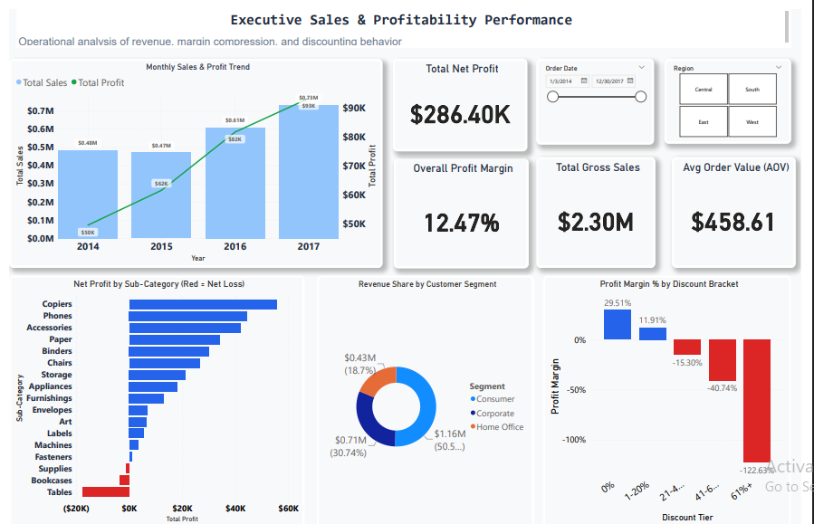
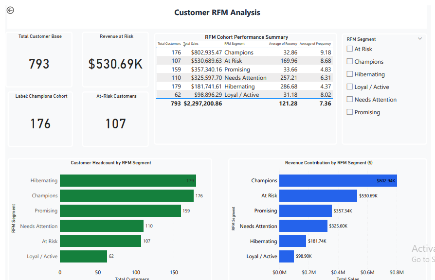

# End-to-End Retail Sales & Profitability Optimization Analysis


An end-to-end business intelligence and data analytics project analyzing **9,994 retail transactions** to evaluate profitability drivers, product-level profit leakage, discount margin sensitivity, and customer lifetime value via RFM segmentation.

---

## 📌 Executive Summary

While the enterprise achieved **$2,297,200.86 in gross revenue** across 5,009 orders, bottom-line profitability was severely eroded by aggressive discounting policies and consistent losses across specific furniture product lines. 

This project audits operational performance using **Python**, validates findings via **MySQL**, and delivers interactive decision-support dashboards in **Power BI**.

### 🔑 Key High-Level KPIs
* **Total Gross Sales:** $2,297,200.86
* **Total Net Profit:** $286,397.02
* **Overall Profit Margin:** 12.47%
* **Total Distinct Orders:** 5,009
* **Total Unique Customers:** 793
* **Average Order Value (AOV):** $458.61
* **Average Fulfillment Duration:** 4.0 Days

---

## 🔍 Core Business Insights

### 1. Product Profit Leakage
While top sub-categories like **Copiers (+$55.6K)**, **Phones (+$44.5K)**, and **Accessories (+$41.9K)** generate strong profit contributions, three sub-categories generated severe net losses:
* **Tables:** -$17,725.48 net loss
* **Bookcases:** -$3,472.56 net loss
* **Supplies:** -$1,189.10 net loss

### 2. Discount & Margin Erosion Analysis (Association Study)
Evaluating discount tiers revealed clear margin compression across ascending discount brackets:
* **0% Discount:** +29.51% aggregate margin ($320.9K profit)
* **1% – 20% Discount:** +11.91% aggregate margin ($100.8K profit)
* **21% – 40% Discount:** **-15.30% margin** (-$35.8K net loss)
* **41% – 60% Discount:** **-40.74% margin** (-$28.9K net loss)
* **61%+ Discount:** **-122.63% margin** (-$70.6K net loss)

*Analysis Note:* Higher discounts demonstrate a negative association with transaction profitability ($r = -0.219$). Category and sub-category heatmaps verify that margins collapse into negative territory across Furniture and Technology whenever promotional discounts exceed 20%.

### 3. Customer RFM Segmentation Framework
Customers were evaluated across **Recency** (days since last purchase), **Frequency** (order count), and **Monetary Value** (total historical spend), segmented into 6 cohorts:

| RFM Segment | Customer Count | % of Customers | Avg Recency | Avg Spend | Total Revenue | % Revenue Share |
|:---|:---:|:---:|:---:|:---:|:---:|:---:|
| **Champions** | 176 | 22.19% | 33.2 days | $4,562.13 | $802,935.47 | **34.95%** |
| **At Risk** | 107 | 13.49% | 170.6 days | $4,959.72 | $530,689.63 | **23.10%** |
| **Promising** | 159 | 20.05% | 35.0 days | $2,247.42 | $357,340.16 | **15.56%** |
| **Needs Attention** | 110 | 13.87% | 253.3 days | $2,959.98 | $325,597.70 | **14.17%** |
| **Hibernating** | 179 | 22.57% | 322.6 days | $1,015.32 | $181,741.61 | **7.91%** |
| **Loyal / Active** | 62 | 7.82% | 31.1 days | $1,595.10 | $98,896.29 | **4.31%** |

* **High-Priority Retention Opportunity:** The **At-Risk** cohort represents only **13.49% of customers** but accounts for **23.10% of revenue ($530.7K)**. Automated win-back campaigns should prioritize this high-value cohort.

---

## 💡 Strategic Recommendations

1. **Discount Cap Policy:** Implement a hard limit capping maximum promotional discounts at **20%**. Any discount above 20% requires regional director approval.
2. **Catalog Restructuring for Tables & Bookcases:** Re-evaluate manufacturing/supplier contracts for Tables (-$17.7K net loss). Discontinue standalone discounts on these SKUs and sell them as bundled packages with high-margin items.
3. **Automated CRM Retention:** Re-engage the 107 "At-Risk" high-value accounts through dedicated account management and personalized retention incentives rather than site-wide price cuts.

---

## 📊 Power BI Dashboard Preview

### Page 1: Executive Sales & Profitability Performance


### Page 2: Customer RFM Segmentation Matrix


---

## 🛠️ Tech Stack & Methods

* **Python (Data Engineering & Analysis):** Pandas, NumPy, Matplotlib, Seaborn
  * Data hygiene: missing value validation, duplicate checks, chronological validation (`invalid_shipping = 0`).
  * Quartile-based RFM scoring using `pd.qcut` and behavioral cohort mapping.
  * Cross-category discount heatmaps.
* **MySQL (Business Intelligence Queries):**
  * Multi-level aggregations (`GROUP BY`, `HAVING`).
  * Window Functions (`SUM() OVER` for cumulative sales, `DENSE_RANK() OVER PARTITION BY` for regional leaderboards).
  * Common Table Expressions (CTEs) for multi-step cohort analysis.
* **Power BI (Visual Analytics):**
  * Dynamic DAX measures: `Profit Margin % = DIVIDE([Total Profit], [Total Sales], 0)`.
  * Conditional formatting for loss-making product categories.
  * Interactive multi-dimensional slicing by Region, Date, and RFM Segment.

---

## 📁 Repository Structure

```text
├── data/
│   └── Superstore.csv                     # Raw transactional dataset
├── notebooks/
│   └── Superstore_Analysis_Final.ipynb    # Python ETL, statistical analysis & visuals
├── sql/
│   └── superstore_analysis.sql            # MySQL analysis script (CTEs, Window functions)
├── power_bi/
│   └── Retail_Analytics_Dashboard.pbix    # Interactive Power BI report
├── visual_assets/
│   ├── dashboard_page1.png                # Executive dashboard screenshot
│   └── dashboard_page2.png                # RFM customer dashboard screenshot
└── README.md                              # Comprehensive project documentation